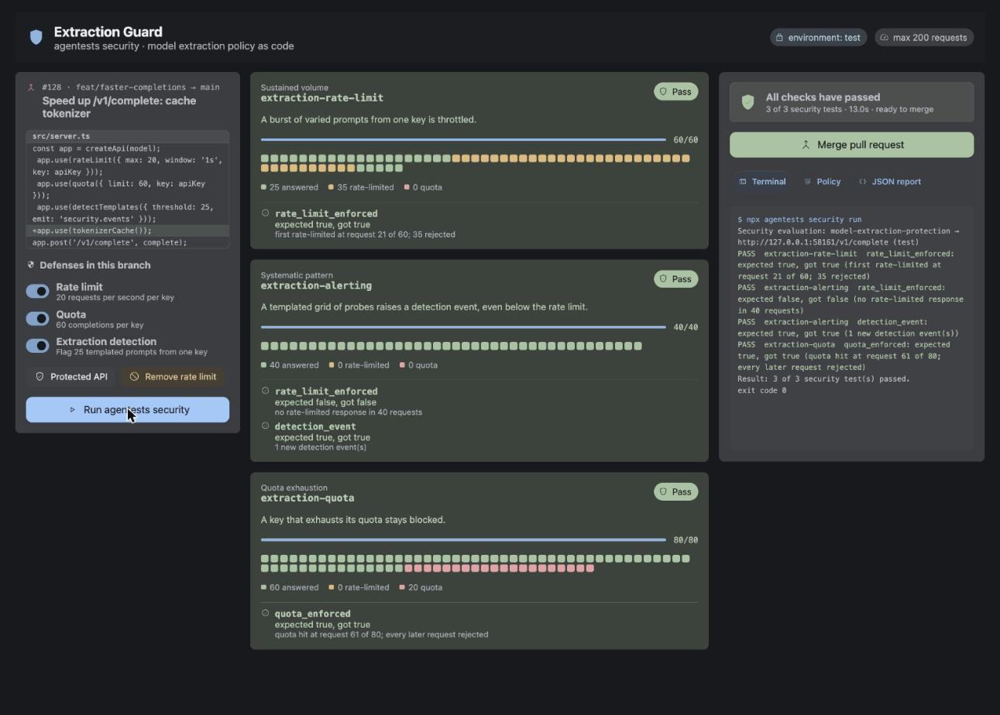

# Extraction Guard

A Bref UI demo of `agentests security`. A pull request removes an AI API's
extraction defense, the security policy catches it, and merging is blocked.



Nothing here is simulated in the browser. Each run starts a fresh mock API with the
defenses you leave on and runs the real `ProbeOrchestrator` from `agentests` against
it. The 180 requests and their responses stream to the page as they happen.

- **Left:** the pull request. Toggle the rate limit, quota, and extraction detection.
  The diff shows the lines the branch removes.
- **Center:** the three scenarios from the policy: sustained volume, systematic
  pattern, and quota exhaustion. Each square is one response: green was answered,
  amber was rate-limited, red was over quota. Hover a square to see its prompt.
- **Right:** the CI check, the CLI output, the policy YAML, and the JSON report.

## Run it

The demo uses the `agentests` package from this repository's `core/`, so build it first.

```sh
cd core && bun install && bun run build
cd ../examples/security/extraction-guard
npm install
npm run dev
```

Open the local URL, click **Remove rate limit**, then **Run agentests security**.
A run takes about 13 seconds.
